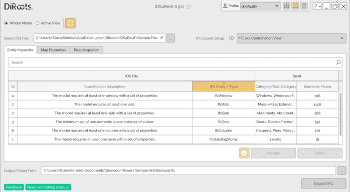
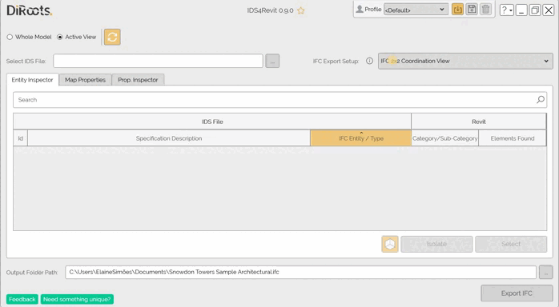
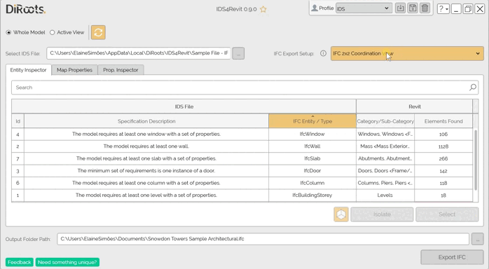

# Profiles
{: .no_toc }

## Table of contents
{: .no_toc .text-delta }

1. TOC
{:toc}

---

## What's saved in the profile

The following settings are saved in the profiles.
- The IFC export setup selection and scope of elements to export. 
- The Mapped properties.
- The input and output folder paths.

## Creating Profiles

IDS4Revit profiles make it easy to save your settings and reuse them later. It is also a handy way for BIM Managers to create standard rules (e.g., filename conventions) and share them across the organization.

1. In the window header, click on the save button next to the profiles list.
2. Name the profile (give it a meaningful name because this is the name that will show up in the profiles list)
3. Choose if you want to create a profile with the default IDS4Revit settings, with your current settings, or import settings from an existing profile.
4. Click on the "Save" button to create the profile.

  
{: .note }
The image may show an earlier version of [IDS4Revit](https://diroots.com/revit-plugins/ids-for-revit/).

{: .new }
BIM managers can save profiles in a shared network location so users can import the same settings. See [Importing Profiles](#importing-profiles).

## Use the profile as default

Once you have saved your profiles with the necessary practice settings, you can also add this profile as default to all teams. Follow the steps:

1. Create a profile into IDS4Revit.
2. Open the following location path %localappdata%\DiRoots\IDS4Revit\Profiles.
3. Copy the Profile file from the current location.
4. Replace it on all users' machines.

The profile will now be immediately visible to users.

## Importing Profiles

IDS4Revit profiles make it easy to import existing profiles to stay compliant with your company standards (e.g., profiles in a network location).

1. In the window header, click on the plus (+) button next to the profiles list.
2. Name the profile (give it a meaningful name because this is the name that will show up in the profiles list)
3. Choose 'Import from file' to import settings from an existing profile
4. Use the Windows File Explorer to find the profile (e.g., in a shared folder, network location, or local computer)
5. Click on the "Create" button to create the profile.

  
{: .note }
The image may show an earlier version of [IDS4Revit](https://diroots.com/revit-plugins/ids-for-revit/).

## Deleting Profiles

1. In the window header, select the profile you want to delete from the drop-down list
2. Click on the delete icon next to the profiles list.
3. Confirm.

  