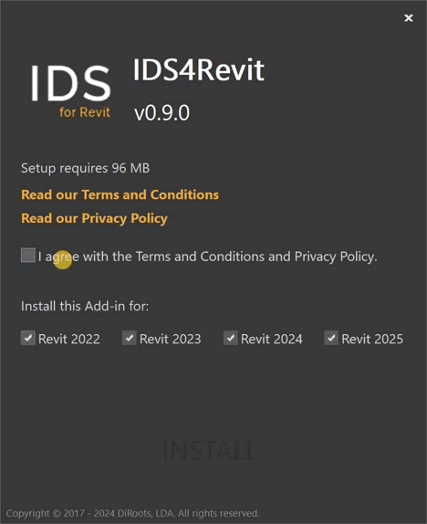
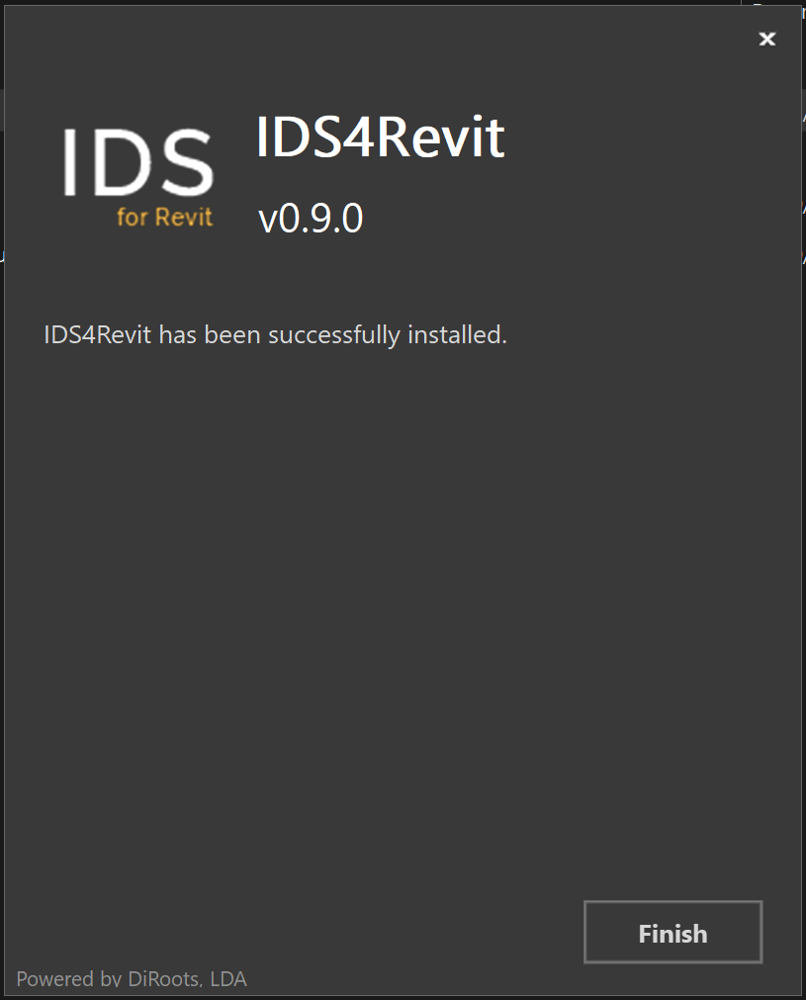
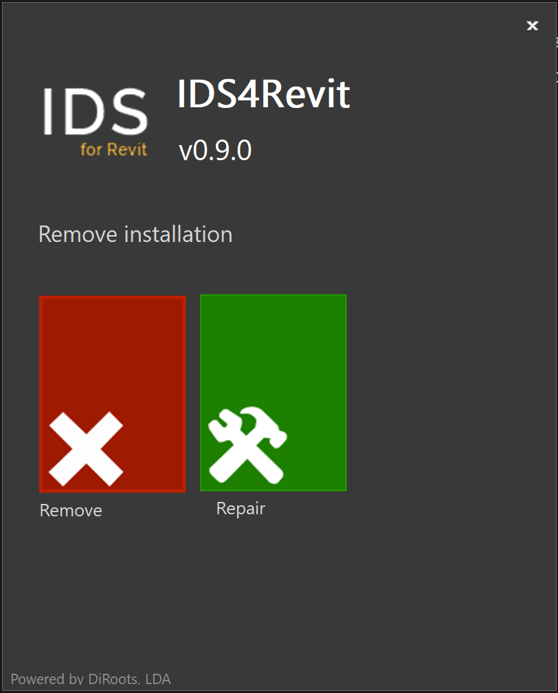
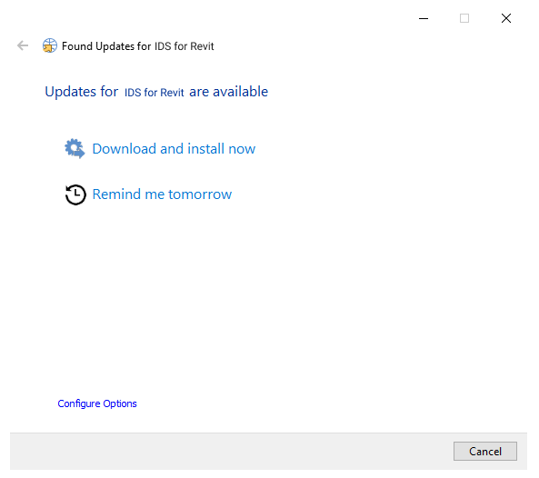

# Getting Started
{: .no_toc }

Install IDS4Revit to check Revit model data against an IDS file, map properties, and export to IFC.

## Table of contents
{: .no_toc .text-delta }

1. TOC
{:toc}

---

## Download

Download the [latest version of IDS4Revit](https://diroots.com/revit-plugins/ids-for-revit/).

## Install

### Compatibility

- Windows 7, 8, 10, and 11.
- Revit 2022, 2023, 2024, 2025, 2026, and 2027.

### Standard Installation

{: .note }
This method is intended for administrators installing IDS4Revit on one computer.

1. Run the IDS4Revit installer.

2. Select the Revit versions and click **Install**.

   

3. Wait for the installation to complete and click **Finish**.

   

4. Restart your computer before opening Revit.

   {: .important }
   Restarting is required to complete the installation.

### Silent Installation

{: .note }
IT administrators can use these commands to deploy IDS4Revit to multiple computers.

- Install for all compatible Revit versions:

```bat
<installer-name>.exe /i // /qn accept_eula=1
```

- Disable automatic update checks:

```bat
<installer-name>.exe /i // /qn accept_eula=1 UPDATER="FALSE"
```

- Exclude specific Revit versions. This example excludes Revit 2022, 2023, and 2024:

```bat
<installer-name>.exe /i // /qn accept_eula=1 revit2022="" revit2023="" revit2024=""
```

## Uninstall

### Using the installer user interface

1. Run the IDS4Revit installer.

2. Select and click **Remove**.

   

3. Wait for the uninstallation to complete and click **Finish**.

### Using the installer silently

Uninstall IDS4Revit without user interaction:

```bat
<installer-name>.exe /x // /qn
```

### From the Control Panel

1. In the taskbar search box, type **Control Panel** and open it.

2. Select **Programs > Programs and Features**.

3. Right-click the program you want to remove and select **Uninstall** or **Uninstall/Change**, then follow the prompts.

## Updates

IDS4Revit includes an updater that checks for new versions when Revit closes. It lets you install the update or be reminded the next day.



### Updater Settings

You can change the update check frequency (two days by default) and the downloads folder.

{: .new }
Automatic update checks can't be disabled in the user interface. You can reduce how often they run by setting the check frequency to 365 days.

{: .warning }
We recommend keeping IDS4Revit up to date. Support is not provided for outdated versions.

{: .new }
IT administrators can change the update check frequency in the updater configuration file.

1. Go to `%programdata%\DiRoots.IDS4Revit\Settings`.

2. Open `updater.ini`.

3. Find `CheckFrequency=2` and change the value, for example, to `365`.

{: .warning }
We recommend keeping IDS4Revit up to date. Support is not provided for outdated versions.
